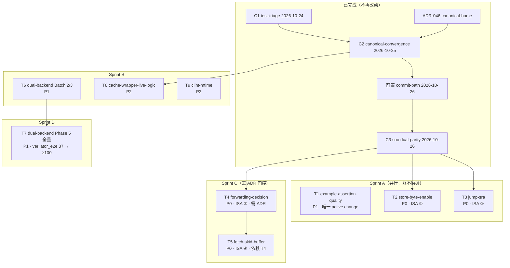

# phase-5 后续任务执行计划（RV32I ISA 收口 · RTL 缺陷收口 · dual-backend 残余）

> **文档性质**：执行侧计划。roadmap 侧的对齐修订已于 2026-10-26 完成
> （`.rddf/roadmap/**` + 根 `AGENTS.md` AUTO 块 + `.rddf/state/.planner-handoff.json`）。
> 本文件把 roadmap 里登记的**候选 change** 落成**可执行步骤**，供 build agent 逐个实施。
>
> **状态**：本文档只描述未来动作，**尚未实施任何一条**。
> 落地方式：每个任务 = 一个 openspec change（`openspec/changes/<name>/`），
> 走 rdd-builder 的 P0→P3 流程（对抗审稿 → archive）。
>
> **kind**: phase-plan（跨 change 的阶段级执行计划；与 `.rddf/plans/<change>.md`
> 的「一个 change 一份 plan」惯例不同 —— 本文件是 **9 个 change 的编排总纲**，
> 落地后每个 change 仍各自在自己的 `.rddf/plans/<change>.md` 里写 TDD 步骤）
> **covers**: T1–T9（见 §1）  **source**: 2026-10-26 roadmap 对齐修订

---

## 0. planner 审查记录（2026-10-26）
**审查范围**：本计划 ↔ `.rddf/roadmap/**` 的双向映射、验收可核性、前置依赖完整性、判据一致性。

### 0.1 映射核对结论 —— **全覆盖，无越界**

| plan 任务 | roadmap 归属 | change 名一致性 |
|---|---|---|
| T1 | 唯一 active change `example-assertion-quality-2026-10` | ✅ |
| T2 / T3 / T4 / T5 | `feat-rv32i-isa-completeness` ① ② ③ ④ | ✅ change 名逐字一致 |
| T6 / T7 | `feat-dual-backend-coverage` Phase 4 残余 / Phase 5 全量 | ✅ |
| T8 / T9 | `feat-riscv-mini-rtl-debt` ① ② | ✅ |
| T10 | phase-5 完成条件里的延后项（Windows / 日历锁 / JIT backlog） | ✅ |

⇒ roadmap 侧无「已登记但计划未覆盖」的项；plan 侧无「计划引入但 roadmap 未登记」的项。
**无需修订 roadmap 的任务清单**（仅需补一条 backlog 候选，见 0.2 F）。

### 0.2 发现的 6 个 gap 与处置

| # | gap | 处置 | 归属 |
|---|---|---|---|
| **A** | T2 / T3 / T5 若需新增 SoC 顶层观测端口 ⇒ 触碰 **ADR-046 D10 的 32 端口冻结** | 每个相关 change 的 proposal MUST 声明：「若需加端口 ⇒ **先改 ADR-046 D10**（rdd-arch 前置）」；builder 不得在 change 内自行扩端口 | rdd-arch |
| **B** | T1 的 macOS-14（BSD/BWK awk）实测**本机不可完成** | 权威结果 = **CI 的 `macos-14` job**；本地只跑 Linux 部分；归档前 MUST 看到该 job 绿 | build + CI |
| **C** | T7 的「`ctest -L verilator_e2e` ≥ 100」**可能不可达** | 开工前先交「可 dual 上限盘点」；若上限 < 100 ⇒ **修订 `objective-test-coverage-100pct` 的 Go 判据**（planner 职责，build 不得自行改判据） | planner |
| **D** | 计数同步纪律未区分「改既有测试」与「新增测试」 | T2 / T3 / T5 改的是**既有**固件与期望值 ⇒ **不新增测试文件 ⇒ `CTEST_TOTAL` 不变**；只有 T6 / T7 / T8 动计数 | build |
| **E** | 「取指双装」若 T5 只做局部规避 ⇒ 残留是否需新登记 | 根 `AGENTS.md §KNOWN LIMITATIONS` **已登记** ⇒ 不需新登记（plan 隐含已正确） | — |
| **F** | `rddf roadmap` 子命令全坏（`script not found at <repo>/skills/roadmap/scripts/*`）⇒ AUTO 块与 fragments 一致性只能手工 ⇒ 本次漂移的根因 | 登记为**独立小 change 候选**「roadmap fragments 一致性自检脚本 + CI 挂载」⇒ 已写入 T10 表 + `roadmap.md` 的 backlog 段 | planner（已登记） |

### 0.3 未决项裁决（升格：build 不再自行决定）

- **未决 #1「wdata lane 对齐放 pipeline 侧还是 TCM 侧」→ 裁决：pipeline 侧。**
  理由：RISC-V store 的源数据本就**低位对齐**，由**总线层**按 `addr[1:0]` 做 lane 选择；
  放在 pipeline 侧与既有 AXI 路径（`include/axi4/byte_lane.h`）**同构**；
  TCM 侧只做「读-改-写 + 掩码合并」，语义单一、可独立测。
- 其余未决项（ADR-046 **D5**、双装是否动框架层、T7 口径）**保持未决** —— 它们分别属
  rdd-arch（T4）与 planner（T7 判据），build 不得自行裁决。

### 0.4 验收可核性抽查 —— 通过

T1 / T2 / T3 / T5 / T8 / T9 均要求「变异验证转红 + 双后端一致」；T4 要求「ADR 落盘 + 裁决落地 + 组合环不复现（实测）」；
T6 要求「3 个 dual pair 绿 + 计数同步」；T7 要求「盘点表作为交付物」。
⇒ 无空洞判据（无「测试通过」这类不可核描述）。

---

## 1. 任务全景



**排期原则**

1. **T2 先于任何「重算固件金标」的任务** —— T2 改 store 写语义，晚做会让金标重算两次。
2. **T4 必须先出 ADR** —— 前推是**行为变更**，接错直接 `FATAL: Cycle detected in IR graph`（`git show bf78367`）。
3. **T5 依赖 T4 的结论** —— 「依赖指令怎么拿数据」定了，「停顿期间指令放哪」才能定。
4. **T1 / T6 / T8 / T9 与 ISA 线互不触碰** ⇒ 可并行。
5. **T7 单独立项** —— 它是「≥100 个 dual 测试」的工程量问题，不是 ISA 问题；别混在一起。

---

## 2. 通用工程约束（每个 change 都适用）

| 约束 | 具体要求 | 护栏 / 验证 |
|---|---|---|
| **TDD 5 步** | ① 先写**可证伪**的失败断言（变异即转红）→ ② 实现 → ③ 双后端 parity → ④ 变异验证 → ⑤ 文档 + 护栏 | `scripts/verify_example_assertion_quality.sh`（断言质量）、`scripts/verify_example_test_wiring.sh`（归属守恒） |
| **禁止「缺陷快照」断言** | 不得写「当前未驱动 ⇒ 读 0」这类**把缺陷写进规格**的断言 | 审稿必查；`examples/riscv-mini/tests/test_cache_smoke.cpp:82-83` 是现存反例 |
| **零债务** | `-Wall -Wextra -Wpedantic` 0 warning；无孤儿文件；`CTEST_TOTAL` 与 `ctest -N` 同步 | `scripts/verify_test_counts.sh` |
| **文档同步** | 同 commit 内更新 `include/cpu/AGENTS.md` / 根 `AGENTS.md`（KNOWN LIMITATIONS 对应条目） | 审稿必查 |
| **双后端** | DUT 必须用**顶层 `ch_out`** 观测（verilator 读不到深层内部）；用 `DUAL_BACKEND_TEST_PAIR` | `tests/dual_backend_fixture.h` |
| **change 生命周期** | `openspec/changes/<name>/{proposal,design,tasks}.md` + delta ⇒ 实施 ⇒ 对抗审稿 ⇒ `openspec archive` | `bash scripts/verify_openspec_delta.sh` |

**基线命令**（每个 change 收尾必跑）

```bash
cmake --build build -j$(nproc) 2>&1 | grep -E "error|warning"   # 0 error / 0 warning
cd build && ctest -LE perf --output-on-failure                    # 当前 191/191
cd build && ctest -N | tail -1                                   # 与 AGENTS.md CTEST_TOTAL 一致
cd build && ctest -L verilator_e2e --output-on-failure           # 双后端相关
bash scripts/verify_test_counts.sh
bash scripts/verify_example_test_wiring.sh
bash scripts/verify_example_assertion_quality.sh
bash scripts/verify_no_duplicate_rv32i_headers.sh
bash scripts/verify_rst_n_wiring.sh
./run_all_ported_tests.sh        # 28/28
bash scripts/run_all_samples.sh  # 35/35
```

---

## 3. 任务详述

### 执行进度（2026-10-26，builder 实做后回填）

| 任务 | 状态 | 证据 |
|---|---|---|
| **T1** `example-assertion-quality-2026-10` | ✅ **已归档**（2026-10-26） | commit `0e765d4` + `2396aa1`；11 fixture + 自检脚本 + 共享 lib；**变异验证 4/4 + 整改后 3 条全被抓**；护栏重构前后输出**逐字一致**；归档 → `openspec/changes/archive/2026-10-26-example-assertion-quality-2026-10/`；新 capability `example-assertion-quality`（2 条 Requirement） |
| T1 剩余门 | ⏳ **合并门**：CI 的 `macos-14` job 绿（本机 Linux 不可完成） | ⚠️ 该 job 红 ⇒ MUST **revert 归档 commit**（含主 spec 新增 capability） |
| **T2** `rv32i-store-byte-enable-2026-10` | ✅ **已归档**（2026-10-26） | `DataTCM` 加 `strbe` + 读-改-写合并（复用 `byte_lane.h`）+ 流水线 lane 对齐（`shl<32>`，**只对 SB/SH** ⇒ `sw` 零回退）+ SoC 接线 + **4 个实例化点显式驱动**；固件尾部追加 `sb`/`sh` 用例（既有 word 索引不动）；归档 → `openspec/changes/archive/2026-10-26-rv32i-store-byte-enable-2026-10/`；新 capability `rv32i-isa-semantics`（2 条 Requirement） |
| T2 剩余门 | ⏳ **合并门**：CI 的 `macos-14` job 绿 | 同上（revert 条件相同） |
| **T3** `rv32i-jump-sra-2026-10` | 🟡 **已实施，待对抗审稿** | commit `0972f4d`；JAL/JALR 重定向（复用条件分支通路，**未**加第三路 PC 源）+ 返回地址走**新增** `link_value` 通路 + SRA 真算术右移（**两处**：`ex_stage` 内联 + `Rv32iAlu` 组件）；**连带修复 2 个既有缺陷**（U 型立即数 / `alu_op` 对 I 型的 SUB 误判）；固件 64 → 100 字；`non_retired` 11 → 17（实测）；**变异 6/6 全被抓**；`ctest -LE perf` 191/191；6229 断言绿 |
| T4–T9 | ⏳ 未开始 | 每个需 planner 的 5 段 improvement 草案 + openspec change |

### 2026-10-26 对抗审稿第 1 轮结果（两个 change 均**无 BLOCKER**）

| change | 结论 | 处置 |
|---|---|---|
| T1 `example-assertion-quality-2026-10` | APPROVE_WITH_CONDITIONS（mergeable: yes） | 2 SHOULD_FIX + 5 NITS **同批整改**（C4 期望值交叉检查 / C5 token 检查 / lib 变量改 `local` / source 路径改 `$REPO_ROOT` / C2 扫描面扩到全部文件 / 端到端 fail-closed 变异补做）⇒ 新增变异 3 条全被抓 |
| T2 `rv32i-store-byte-enable-2026-10` | APPROVE_WITH_CONDITIONS（mergeable: yes / scope_exceeded: true） | 3 SHOULD_FIX + 2 NITS **同批整改**（design.md §5 的非对齐 `sh` 声称改正 / `test_riscv_tests_pipeline` 的 `strbe` 改为随写路径 mux / spec Requirement 收窄到 `DataTCM.strbe` 并把框架层约定移到 `AGENTS.md`） |

### 2026-10-26 对抗审稿第 2 轮（复审）结果 —— 两个 change 均 **APPROVE**

| change | 结论 | 剩余 |
|---|---|---|
| T1 `example-assertion-quality-2026-10` | **APPROVE**（mergeable: yes / scope_exceeded: false）—— 无 BLOCKER、无 SHOULD_FIX | 1 NIT（lib 头注释的用法示例已与真实消费者不一致 ⇒ 已改为展示 `$REPO_ROOT` / `$SCRIPT_DIR` 两种真实写法） |
| T2 `rv32i-store-byte-enable-2026-10` | **APPROVE**（mergeable: yes / scope_exceeded: false）—— 无 BLOCKER、无 SHOULD_FIX | 1 NIT（`AGENTS.md` 指向本 change 新建的 capability ⇒ **归档前悬空** ⇒ 归档后自动消解，已核实） |

⇒ 两个 change 均**已归档**（2026-10-26）；审稿预算**用尽**（各 2 轮）⇒
后续若再改这两个 change 的内容，**MUST 开新 change**（不得再走第 3 轮复审）。

### backlog（审稿产出，**不在** T1/T2 内返工）

- **「任意新增输入端口 ⇒ 全实例化点 MUST 显式驱动」的 rst_n 同型自动化护栏**
  （critic 标 `scope_exceeded`）：需要先设计「必需端口注册表」
  （不同端口的未驱动读值语义不同：`rst_n` 读 0 = 永久复位、`strbe` 读全 1 = 碰巧整字写）
  ⇒ 已登记进根 `AGENTS.md` 的约定层 ⇒ **独立立项**（建议单开一个 change）。

> **T3 实施中挖出的三个可复用事实**（已写进 `include/cpu/AGENTS.md` 的约定层）：
> ① **`funct7[5]`（= `instr[30]`）只对 R 型 与 SRAI 有意义** —— 对 I 型那是 `imm[10]`
>    ⇒ 用它判 SUB 会把 `imm >= 0x400` / 负数误判成 SUB（既有固件 imm 全 `< 0x400` 才侥幸
>    未暴露）；**任何按 `funct7` 分派 ALU 操作的代码 MUST 用 opcode 门控**；
> ② **U 型立即数 MUST 是 `instr[31:12] << 12`** —— 20 位掩码再左移会把 `rd`/`opcode`
>    算进去（`auipc x18, 0` ⇒ `pc + 0x917000`）；
> ③ **新端口的「间接验证」陷阱**：`link_value` 没有观测端口（D10 冻结 32 端口）
>    ⇒ 只能靠写回值间接验证 ⇒ 写回序列断言是它的**唯一**判据。

> **T2 实施中挖出的两个可复用事实**（已写进 capability `rv32i-isa-semantics`）：
> ① **未驱动的输入端口读到的是「全 1」而不是 0** ⇒ 依赖默认值的实现会「碰巧」通过
>    ⇒ 新增输入端口时 MUST 逐个实例化点显式接线；
> ② `ch_uint::operator<<` 按 RHS 的**类型宽度**推算结果宽度 ⇒ **运行期移位量**
>    MUST 用 `shl<N>`（显式结果宽度），否则宽度算错。


### T1 · `example-assertion-quality-2026-10`（P1 · 唯一 active change）

- **目标**：把「断言质量」维度做成**可执行规格**（fixture 集 = 期望值表），并完成跨平台实测。
- **前置**：C1 已归档（护栏脚本与 CI 挂载已随 C1 拆分交付，commit `fadf500`）。
- **涉及文件**：`tests/fixtures/assertion_quality/*`（新建 10 个）、`scripts/verify_assertion_quality_fixtures.sh`（新建）、`.github/workflows/ci.yml`。
- **步骤**（照 `openspec/changes/example-assertion-quality-2026-10/tasks.md` 推进）
  1. T1.1 建 10 个 fixture（`live_assert` / `commented_out` / `dead_macro` / `dead_elif` / `dead_ifdef_else` / `live_else` / `live_elif` / `word_boundary` / `throws_only` / `succeed_only`）
  2. T1.2 建自检脚本：逐 fixture 断言「可执行断言数 `A`」与「逐用例计数」的期望值
  3. T1.3 挂进 CI（与两个护栏同处 2 个 job）
  4. T2.2 确认 `verify_example_test_wiring.sh` 内**零**静态分析代码（`grep -c 'analyze_source\|CH4_ANCHOR\|count_asserts'` = 0）
  5. T3.5.1 补 2 个「分析器失效」fixture（`analyze_source` 返回空 / awk 中途 `exit 3`）⇒ MUST 报违规而非假 OK
  6. T3.1–T3.3 **macOS-14（BSD/BWK awk）实测**并把结果写进 proposal（C1 第 6 轮才发现「组内 `^`」在 POSIX 未定义 ⇒ 不可省）
     ⚠️ **planner 审查补注**：本机是 Linux ⇒ 本地只跑 Linux 部分；**权威结果是 CI 的 `macos-14` job**
     ⇒ 归档前 MUST 看到该 job 绿（禁止用「假定 OK」代替）
  7. T4.1–T4.6 验收：护栏绿 + fixture 10/10 + **变异验证 4 条全被抓**（注释掉断言 / 死宏体 / `#elif` 死分支 / `SUCCEED`-only）+ `#if 0 / #else` 活断言**不**误报 + `openspec validate --strict` 过 + 归属护栏仍绿
- **验收标准**
  - [ ] 10 个 fixture 的期望值由**自检脚本**断言（不是散文描述）
  - [ ] 4 条变异验证全部转红（脚本 MUST 校验**编译成功** —— 编译失败的变异会跑旧二进制 ⇒ 假绿）
  - [ ] macOS-14 实测结果**写进 proposal**（禁止「假定 OK」）
- **风险**：自研 C 子集分析器**不可能被完全闭合**（C1 已实测 3 轮）⇒ 边界 MUST 写进护栏头（「不覆盖等量替换 / 宏生成用例」），不得声称全覆盖。

---

### T2 · `rv32i-store-byte-enable-2026-10`（P0 · ISA ①）

- **目标**：SB / SH 在 SoC 级真正生效（当前**完全不生效**）。
- **事实依据（2026-10-26 实测）**
  - `include/cpu/pipeline/stages/mem_stage.h:182-200` **已**按 `funct3` 正确生成 lane 掩码（`sb_be` 按 `byte_offset`、`sh_be` 按 `half_offset`）并输出 `store_byte_enable_out`
  - `include/cpu/pipeline/rv32i_pipeline.h:369` 已转出 `data_strbe` ⇒ **但全仓无消费者**
  - `include/cpu/pipeline/rv32i_tcm.h:71-105` 的 `DataTCM` **没有 strbe 端口**；SoC 装配 `examples/riscv-mini/src/rv32i_pipeline_top.h:121-126` 只接 addr/wdata/write/valid
  - ⚠️ `rv32i_pipeline.h:364` `data_write_data <<= exmem_rs2_data` —— **未**按 `addr[1:0]` 左移 ⇒ 只加 strbe 端口会把**低字节**写进高 lane（更隐蔽的错误）
- **实现要点**
  1. `ch_mem` **没有**字节使能写 API（`include/core/mem.h:195` 的 `write(addr, data, enable)`）⇒ SB/SH 需在 `DataTCM` 内做 **read-modify-write**：`old = memory.aread(addr)`（0-cycle 组合读，与 MEM 级采样同拍）→ `merged = byte_lane_apply<32,32>(old, wdata, strbe)`（复用 `include/axi4/byte_lane.h`）→ `memory.write(addr, merged, we & valid)`
  2. **wdata lane 对齐**必须在**一处**显式决定并写进 change：RISC-V 规定 SB/SH 的源数据落在 `addr[1:0]` 对应 lane ⇒ 推荐在 **pipeline 侧**做 `rs2 << (8 * addr[1:0])`（与 AXI 互连的 byte-lane 语义一致），TCM 侧只做掩码合并
  3. `DataTCM` 加 `ch_in<ch_uint<4>> strbe` 端口；`rv32i_pipeline_top.h` 接线 `dtcm.io().strbe <<= pipeline.io().data_strbe`
  4. ⚠️ 同一 `ch_mem` 同时挂 `aread` + `write` 的 codegen 路径**已有先例**（`tests/test_stream_fifo_dual.cpp`）⇒ 沿用即可
- **涉及文件**：`include/cpu/pipeline/rv32i_tcm.h`、`include/cpu/pipeline/rv32i_pipeline.h`、`examples/riscv-mini/src/rv32i_pipeline_top.h`、`examples/riscv-mini/tests/test_rv32i_soc_dual_parity.cpp`（固件 + 断言）、可能新增 `tests/test_rv32i_store_byte_enable.cpp`
- **步骤**
  1. 写**失败**断言：固件 `sw 0xFFFFFFFF` → `sb 0x00` 到 offset 1/2/3 → 读回逐字节正确（先红）
  2. 实现 `DataTCM` 的 strbe + RMW 合并 + wdata lane 对齐
  3. 双后端 parity（interpreter + verilator）
  4. 变异验证：把 lane 对齐去掉 ⇒ 转红；把 strbe 传 0xF ⇒ 转红
  5. 更新 `include/cpu/AGENTS.md` + 根 `AGENTS.md §KNOWN LIMITATIONS`（删掉「字节级写在当前 SoC 里仍不生效」那条）
- **验收标准**
  - [ ] SB / SH 在 offset 0/1/2/3 下逐字节正确
  - [ ] `data_strbe` 在 SoC 里有消费者（grep 可见）
  - [ ] 双后端逐拍一致
  - [ ] 变异验证：去掉 lane 对齐 ⇒ 转红
- **风险**：RMW 引入**读-改-写同拍**语义 ⇒ 需确认与 `ch_mem` 的 `aread`/`write` 组合不产生组合环（`aread` 是组合读，`write` 是时序写 ⇒ 无环）。
- **回滚**：单文件回退 `rv32i_tcm.h` / `rv32i_pipeline.h` / `rv32i_pipeline_top.h` 三个文件即可（固件用例保留为已知失败）。

---

### T3 · `rv32i-jump-sra-2026-10`（P0 · ISA ②）

- **目标**：JAL / JALR 真正重定向 PC 且写回正确；SRA 变成真算术右移。
- **事实依据**
  - `include/cpu/pipeline/rv32i_decoder.h:46-47,135,145` **已**解码 `OP_JAL` / `OP_JALR`（`imm_j` / `imm_i`）⇒ **缺口不在 decoder**，在 pipeline 接线
  - `include/cpu/pipeline/rv32i_pipeline.h:180` `if_stage.io().branch_valid <<= ex_stage.io().branch_taken;` ⇒ JAL/JALR 的「无条件跳」被丢掉
  - `include/cpu/pipeline/stages/if_stage.h:76-80` 的 PC 选择器只有**两路**：`select(branch_valid, branch_target, pc_plus_4)`
  - `include/cpu/pipeline/stages/ex_stage.h:134` `ch_uint<32> sra_result = srl_result;` ⇒ SRA == SRL
- **实现要点**
  1. `if_stage` 增加第三路 PC 源（`jump_valid` / `jump_target`），选择器扩为三路；**同时复核 `if_stage.h:88-96` 记录的隐式不变量**（「flush 的唯一来源是 `ex_branch & ex_branch_taken`」）—— JAL 引入第二个「无条件跳转」来源 ⇒ MUST 显式说明 flush 与 jump 的互斥论证
  2. `rv32i_pipeline.h` 接线：JAL/JALR 的 `jump_target`（JAL = pc + imm_j；JALR = (rs1 + imm_i) & ~1）与 `jump_valid`
  3. JAL/JALR 的**写回**：`rd = pc + 4`（当前流水线是否有「写回 PC+4」的通路？若无 ⇒ 本 change 需补，属**范围扩张点**，change 里必须显式列出）
  4. `ex_stage.h` 的 `sra_result` 改成真算术右移（`ch_uint<32>` 的符号扩展右移；注意 `ch_uint` 无符号 ⇒ MUST 显式处理符号位，不能直接 `>>`）
- **步骤**
  1. 失败断言：JAL/JALR 固件（跳到子程序 + `ra` 回读）+ `-8 >> 1 == -4` 用例
  2. 实现 PC 三路选择 + 接线 + 写回
  3. 实现真 SRA
  4. 双后端 parity + 变异验证（把 SRA 改回 SRL ⇒ 转红；把 JAL 目标接成 pc+4 ⇒ 转红）
- **验收标准**
  - [ ] JAL / JALR 跳转正确、`ra` == 返回地址
  - [ ] SRA 对负数正确
  - [ ] `if_stage` 的 flush/jump 互斥不变量**有新论证**（不是沿用旧的）
  - [ ] 双后端一致 + 变异验证转红
- **风险**：写回通路可能缺失 ⇒ 若需扩流水线写回接口，本 change 体积会显著上升 ⇒ 宁可**拆成两个 change**（JAL/JALR 目标 / JAL 写回），也不要在一次里改两件事。

---

### T4 · `rv32i-forwarding-decision-2026-10`（P0 · ISA ③ · **需 ADR**）

- **目标**：裁决 ADR-046 **D5**（lib 流水线是否接数据前推），并按裁决清理 `HazardUnit` 的 5 个预留输入端口。
- **事实依据**
  - `include/cpu/pipeline/hazard_unit.h:46,65-67` 的 `wb_reg_write` / `wb_rd_addr` / `ex_alu_result` / `mem_alu_result` / `wb_write_data` 是**公共 API 面上的预留输入**（无内部消费者）
  - lib 版 `HazardUnit` 的 `io().rs1_data = io().rs1_data_raw`（**不接前推**）；接上会在真实装配形成**组合环** ⇒ `FATAL: Cycle detected in IR graph during topological sort`（`git show bf78367`）
  - **已有可复用的正确实现**：`chlib::ForwardingMux`（`include/chlib/forwarding.h`），档位语义与原 mux **逐档等价**（0→REG / 1→EX / 2→MEM）⇒ 前推若接，走 ForwardingMux，**零新增组件**
- **步骤**
  1. **先出 ADR**（rdd-arch 职责）：裁决「接 / 不接前推」+ 组合环的规避方案 + 对固件的约束（当前固件靠「load-use 停顿 + 手工 NOP」自保）
  2. 按 ADR 实施：接 ⇒ 用 `ForwardingMux` 改 `HazardUnit` 的 `rs1_data`/`rs2_data` 驱动；不接 ⇒ 保留现状但**把 5 个预留端口的语义写进头注释**（公共 API 面的诚实描述）
  3. 端口清理：若裁决为「不接且不保留」⇒ 删端口是**破坏性 API 变更** ⇒ 需在 ADR 里写迁移说明
  4. 回归：固件（去掉手工 NOP 的那一版先不引入，见 T5）+ 全量 ctest
- **验收标准**
  - [ ] ADR 落盘（`docs/adr/ADR-0xx-*.md`）且被 change 引用
  - [ ] 裁决**要么**实现前推**要么**如实记录「不接」及其固件约束
  - [ ] 若接前推：`git show bf78367` 的组合环**不复现**（以实测为准，不以推理为准）
  - [ ] `HazardUnit` 的预留端口状态与 ADR 一致（不再「半驱动半死」）
- **风险**：接前推是最容易**制造组合环**的一步 ⇒ MUST 先有 ADR + 最小复现，再动实现。

---

### T5 · `rv32i-fetch-skid-buffer-2026-10`（P0 · ISA ④ · 依赖 T4）

- **目标**：消除「load-use 停顿丢弃消费者之后的第一条指令」与「取指填充期同一条指令被装两次」。
- **事实依据**
  - imem 是 1-cycle `sread` ⇒ 停顿那一拍「已提交但未锁存进 IF/ID」的指令无处可存 ⇒ **从指令流里消失**
  - `ch_mem::sread` 的 `data_proxy` 在**建图期**被组合求值过一次 ⇒ 其初值 = `mem[addr(拍0)]`；拍 1 装的是同一地址的真数据 ⇒ 同一条指令进流水线两次（**幂等、语义无害，但退休数 +1**）
  - 后者根因在**框架层**（`ch_mem` 读端口语义）⇒ 影响**所有** `sread` 用户（imem / FIFO / cache）
- **实现要点**
  1. **优先局部规避**：取指 skid buffer（IF/ID 旁挂 1 深缓冲）解决「停顿丢指令」，**不**动框架层 `sread` 语义
  2. 「取指双装」若要根治 ⇒ 改框架层（`include/ast/mem_port_impl.*` / `src/ast/mem_port_impl.cpp`）⇒ 影响面清单 MUST 逐个列出（`sread` 用户：imem、`chlib::sync_fifo`、cache Sync 变体、AXI 互连相关读口……）
  3. 若框架层改动风险过高 ⇒ 降级为「**显式登记的已知残留**」并在 ADR 里写明代价（退休数不可信 ⇒ 性能计数器不能用）
- **步骤**
  1. 写失败断言：固件**删掉所有手工 NOP** 后仍逐拍正确（这是本 change 的核心判据）
  2. 实现 skid buffer（含 flush 交互：flush 时 buffer 内容 MUST 同步失效）
  3. 双装：先量化（退休数 vs 实际指令数），再决定「修」还是「登记」
  4. 双后端 parity + 变异验证（skid buffer 关闭 ⇒ 应复现「丢指令」⇒ 转红）
- **验收标准**
  - [ ] 固件无手工 NOP 仍正确执行
  - [ ] 退休指令数 == 实际指令数（或**明确登记**为残留并写进 ADR）
  - [ ] flush 期间 skid buffer 行为自洽（有断言）
  - [ ] 框架层若被改 ⇒ 影响面清单逐项回归通过
- **风险**：**最高**的一项 —— 改框架层 `sread` 会波及所有用户 ⇒ 建议**先做 skid buffer（局部）**，双装单独评估。

---

### T6 · `dual-backend-rv32i-integration` Batch 2/3（P1）

- **目标**：把 `feat-dual-backend-coverage` Phase 4 的残余做完 ⇒ `objective-rv32i-e2e` 的 Go 判据第 5 条达成。
- **范围**（依据 `tests/test_rv32i_pipeline_behavior.cpp` 文件头的 Batch 划分）
  - Batch 2：`IfIdPipelineReg` —— transfers PC and instruction（clk-spike）+ clears instr_valid on flush
  - Batch 3：`BranchPredictor` —— BNT strategy
- **步骤**
  1. 先做 **clk-spike**（单独一个测试目标，验证「含时钟的组件能否走 dual」）⇒ 若 spike 失败 ⇒ 先记原因，不强推
  2. 按 spike 结论补 3 个 `DUAL_BACKEND_TEST_PAIR`
  3. 变异验证
- **验收标准**
  - [ ] 3 个 dual pair 绿；`ctest -L verilator_e2e` 计数 +3（37 → 40，**同步 `AGENTS.md` 计数**）
  - [ ] spike 结论（成功 / 失败原因）写进 change
- **风险**：含 clk 的组件在 verilator 下需要顶层端口观测 ⇒ DUT 形态与现有 fixture 可能不同。

---

### T7 · `dual-backend-full-coverage` Phase 5 全量（P1 · 大）

- **目标**：`ctest -L verilator_e2e` 从 **37 → ≥ 100**（`objective-test-coverage-100pct` 的 Go 判据）。
- **关键判断**：这是**工程量问题**，不是 ISA 问题 ⇒ 单独立项，且**必须先量化**：
  1. 盘点可 dual 的测试源（`tests/test_*.cpp` 117 + `tests/chlib/test_*.cpp` 29 + `tests/jit/test_*.cpp` 3 + examples 17）
  2. 按 `openspec/specs/dual-backend-test-coverage/spec.md` 的**排除清单**逐条判定（编译期 / 裸 context / aread-based / >64-bit 端口 / SECTION 重入 …）
  3. 给出**可达上限**估算：若排除后上限 < 100 ⇒ **MUST 修订判据**（把「≥100」改成可达值 + 说明），而不是硬凑
- **步骤**
  1. 量化盘点（不改代码）→ 产出「可 dual 清单 + 排除理由表」
     ⚠️ **planner 决策门**：若盘点出的**可达上限 < 100** ⇒ **不得硬凑** ⇒ 由 planner 修订
     `objective-test-coverage-100pct` 的 Go 判据（build 不得自行改判据）
  2. 按「单文件单 change」或「按目录分批」推进（每批 ≤ 10 个测试文件）
  3. 每批：双跑 + 逐周期比对 + 变异验证 + 计数同步
  4. 遇到 verilator codegen 的系统性缺陷 ⇒ **停下来开独立 change**（不要在覆盖 change 里顺手修 codegen）
- **验收标准**
  - [ ] 判据可达性已量化并与用户确认（若 < 100 则修订判据）
  - [ ] 覆盖提升有据（每批 +N，计数同步）
  - [ ] 排除清单里的每一条都有**具体理由 + 依据**（不是笼统「不支持」）
- **风险**：⚠️ `ctest -L verilator_e2e` 的 label 语义要核对（一个 `DUAL_BACKEND_TEST_PAIR` = 1 个 ctest 条目内含 2 个 TEST_CASE）⇒ 「≥100」是 **ctest 条目数**还是 **TEST_CASE 数**，口径必须先统一，否则目标本身是错的。

---

### T8 · `riscv-mini-cache-wrapper-live-logic-2026-10`（P2）

- **目标**：两个 cache wrapper 真正发射分支逻辑（当前**功能上死的**）。
- **事实依据**：`include/cpu/cache/d_cache_write_buffer.h:97` 的 `if (io().req == ch_bool(true) && io().we == ch_bool(true))` 在**建图期**求值 ⇒ 分支体内 `io().ready <<=` **从不发射**；`i_cache_prefetch.h` 同类（且**从未**把 `addr`/`req` 接到内层 cache）
- **步骤**
  1. 写**失败**断言（可证伪）：`req && we ⇒ ready == 1`；`axi_ready ⇒ axi_valid == 1`；`axi_addr`/`axi_wdata` 反映被写数据；`ICachePrefetch` 的 `miss` 随地址变化
  2. 用 `select()` / `chlib/if_stmt.h` 的 `_if()` 替换建图期 C++ `if`
  3. `ICachePrefetch` 把 `addr`/`req` 真正接到内层 `ICacheSync`
  4. `DCacheWriteBuffer` 的 `buffer` 从普通 struct 数组换成**节点数组**（ADR-039 口径；当前 `io().axi_addr <<= buffer[oldest].addr;` 是**注释掉的**）
  5. **同步反转** `examples/riscv-mini/tests/test_cache_smoke.cpp:82-83` 的两条「缺陷快照」断言 ⇒ 改成行为断言
  6. 变异验证
- **验收标准**
  - [ ] `include/cpu/cache/**` 内零「建图期 C++ `if` 控制 RTL 发射」（grep 可查）
  - [ ] `test_cache_smoke` 无「钉住缺陷现状」的断言
  - [ ] 修好后 `ctest -LE perf` 仍全绿
- **风险**：修好 wrapper 后**若**将来把它接进 RV32I 数据通路，行为会变 ⇒ 本 change **不**做接线（只保证 wrapper 自身正确）。

---

### T9 · `clint-mtime-autoincrement-2026-10`（P2）

- **目标**：`CLINT::mtime` 成为**自由运行计数器**（RISC-V 规范的 machine timer），当前只是「静态比较器」。
- **涉及文件**：`include/cpu/riscv/clint.h`、`examples/riscv-mini/tests/test_interrupt_flow.cpp`（可能）、新建 `tests/test_clint.cpp`。
- **步骤**
  1. 写失败断言：连续 N 拍后 `mtime == N`（从 0 起或从初值起，**先定义清楚**）
  2. 实现递增（注意：`mtime` 当前是软件可写 ⇒ **必须显式定义**「软件写是覆盖还是重载」——否则出现两个驱动源的静默冲突）
  3. `mtimecmp` 比较语义复核
  4. 变异验证
- **验收标准**
  - [ ] `mtime` 随拍递增；写端口语义在头注释里写明
  - [ ] `test_interrupt_flow` 仍绿
- **风险**：低（孤立组件，无生产消费者）。

---

### T10 · 延后项（**本轮不排期**）

| 项 | 状态 | 触发条件 |
|---|---|---|
| Windows-2022 CI | 跨 phase-3/4/5 三阶段 ⏳ | phase-5 收口时仍未启用 ⇒ 转 phase-6 并记录理由（No-Go 判据已写入 `phase-5.md`） |
| 逻辑算子 `[[deprecated]]` 移除 | **日历锁** | ADR-036 §8.1：**2027-04-17 前拒绝任何移除 commit** ⇒ 归 phase-6 calendar-gated 清单 |
| `jit-mem-read-port-support` | **backlog，未立项** | 出现「必须 JIT-native 跑 RV32I」的真实需求（JIT 回落是**有意设计**且已断言） |
| 取指填充期双装（若 T5 决定只做局部规避） | 残留登记 | 需要「退休数可信」时（根 `AGENTS.md §KNOWN LIMITATIONS` 已登记 ⇒ 不需新登记，gap E） |
| **roadmap fragments 一致性自检脚本 + CI 挂载** | **backlog 候选**（planner 2026-10-26 登记，gap F） | 起因：`rddf roadmap` 子命令全坏（`script not found at <repo>/skills/roadmap/scripts/*`）⇒ AUTO 块 / Fragment Index / R1–R8 校验只能手工 ⇒ 本次多类漂移的根因。**独立小 change**，不占 phase-5 完成条件 |

---

## 4. 实施时必须知道的事实备忘

1. **ch_mem 无字节使能写**（`include/core/mem.h:195`）⇒ SB/SH 走 DataTCM 内 RMW；复用 `include/axi4/byte_lane.h` 的 `byte_lane_apply<W, BUS_WIDTH>`。
2. **同一 ch_mem 同时挂 aread + write 的 codegen 路径已有先例**：`tests/test_stream_fifo_dual.cpp`。
3. **decoder 已支持 JAL/JALR**（`rv32i_decoder.h:46-47`）⇒ T3 的缺口在 pipeline 接线，不在译码。
4. **`if_stage` 的 PC 选择器只有两路**（`if_stage.h:76-80`），且 `if_stage.h:88-96` 记录了一条**隐式不变量**（flush 的唯一来源）⇒ 引入 JAL 必须重做这条论证。
5. **前推的组合环**：`git show bf78367` 是历史事故记录，不是臆测；已有 `chlib::ForwardingMux`（`include/chlib/forwarding.h`）可复用。
6. **`sread` 的 1 拍 `pc_lag`**：imem MUST 用 `sread`（ADR-041）⇒ IF/ID 的 pc 同样延迟；**dmem MUST 用 `aread`**（0-cycle）。
7. **SoC 端口契约是冻结的**：ADR-046 **D10-rev** 冻结 32 端口（5 输入 + 27 输出）⇒ T2/T3/T5 若需加观测端口，**MUST 先改 ADR-046 D10**（`openspec/changes/rv32i-pipeline-commit-path-2026-10/design.md` §3.10 是先例）。
8. **双后端 DUT 形态**：只能用顶层 `ch_out` 观测（verilator 读不到深层内部）。
9. **金标位置**：`examples/riscv-mini/tests/test_rv32i_soc_dual_parity.cpp`（200 拍 × 27 观测，无掩码）⇒ T2/T3/T5 改的是**同一份**金标的期望值。
10. **`ctest -L verilator_e2e` 的口径**：一个 dual pair = 1 个 ctest 条目（含 2 个 TEST_CASE）⇒ T7 的「≥100」必须先统一口径。

---

## 5. 未决项（需裁决 / 需用户确认）

| # | 事项 | 建议 | 谁裁 |
|---|---|---|---|
| 1 | wdata lane 对齐放在**pipeline 侧**还是 **TCM 侧** | ✅ **已裁决：pipeline 侧**（planner 2026-10-26；理由见 §0.3 —— 与 AXI byte-lane 路径同构，TCM 只做掩码合并） | 已裁决，build 直接执行 |
| 2 | ADR-046 **D5**：接不接数据前推 | 倾向**接**（用 `ForwardingMux`，零新增组件），但**必须先 ADR + 最小复现** | rdd-arch + 用户 |
| 3 | 「取指双装」是否动框架层 `sread` 语义 | 倾向**不���**（只做 skid buffer，双装登记为残留） | 用户 |
| 4 | T7 的「≥100」口径（ctest 条目 vs TEST_CASE） | 先量化再定；不可达则**修订判据**而不是硬凑 | planner + 用户 |
| 5 | sprint 编号口径（roadmap 说 sprint-2026-10，台账说 sprint-2026-11） | 以 roadmap.md 为准（本次已按此记澄清行） | 用户（已默认） |
| 6 | `rddf roadmap` 子命令全坏（`script not found at <repo>/skills/roadmap/scripts/*`）⇒ AUTO 块只能手工 | 修工具安装；或先在 CI 加「AUTO 块与 fragments 一致」的自检脚本 | 用户（可作为独立小 change） |
| 7 | `openspec` CLI 已是 1.14.3（`AGENTS.md` 说钉 1.4.1）⇒ `validate --specs --strict` 8 passed / 15 failed | 与本计划无直接关系，但**任何新 change 的 spec delta 都会撞上 1.14.x 的两条新规则**（Purpose 占位 / 正文 >500 字符）⇒ 写 delta 时按 1.14.x 规范来 | build agent（写 delta 时注意） |

---

## 6. 建议的 Sprint 切分

| Sprint | 任务 | 理由 |
|---|---|---|
| **A**（并行） | T1（唯一 active change，先清掉）· T2（P0，无前置）· T3（P0，无前置） | T1 是既有 active change，不清会一直占着「唯一 active」状态；T2/T3 无前置且互不触碰 |
| **B**（并行） | T6（Batch 2/3）· T8（cache wrapper）· T9（CLINT） | 三个都**不触碰** ISA 线与流水线时序 ⇒ 爆炸半径小 |
| **C**（串行，ADR 门控） | T4（先 ADR）→ T5 | T4 的裁决决定 T5 的形态；两者都会重算时序金标 ⇒ 串行 |
| **D**（大，独立） | T7（Phase 5 全量） | 需要先量化可达上限；不宜与 ISA 线并行（都改测试计数） |
| **E**（延后） | T10 全部 | 日历锁 / No-Go / backlog |

> ⚠️ **计数同步纪律**：T2/T3/T5/T6/T7 都会新增/修改测试 ⇒ 每批 MUST 同步 `AGENTS.md` 的
> `CTEST_TOTAL` 与（若涉及 examples 源文件）`EXAMPLES_TEST_SOURCES`，并跑
> `scripts/verify_test_counts.sh`。
> ⚠️ **planner 审查细化**（gap D）：**「改既有测试」≠「新增测试」** ——
> **T2 / T3 / T5 改的是既有固件与期望值 ⇒ 不新增测试文件 ⇒ `CTEST_TOTAL` 不变**（不要误改计数）；
> 只有 T6（+3 dual pair）、T7（批量）、T8（fixture 目录）才动计数。
> 根 `AGENTS.md` 的 `CTEST_TOTAL` 是 CI 的**单一真相**（`scripts/verify_test_counts.sh` 解析它）。
